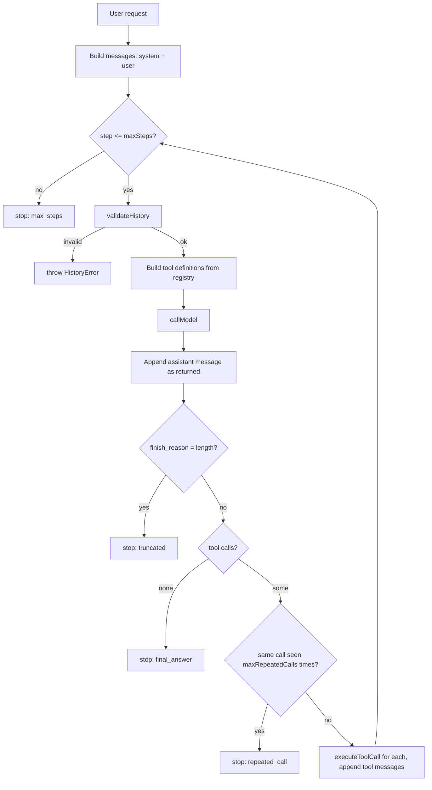

# agent-lesson1: a minimal tool-calling agent in TypeScript

A tool-calling agent built from scratch: no agent framework and no LLM SDK. Just `fetch`, Zod and the agent loop, written by hand so every step can be seen.

It sends a user request to an LLM (an Anthropic model via [OpenRouter](https://openrouter.ai)), lets the model request tools, validates and runs those tools in application code, and loops until the model gives a final answer or a guard stops it.

> **Key idea:** the model never runs anything. It only *requests* a tool call in a structured format. This application validates the request, runs the tool and sends the result back.

---

## Contents

- [Quick start](#quick-start)
- [Example run](#example-run)
- [How it works](#how-it-works)
- [Project structure](#project-structure)
- [Tools](#tools)
- [Failure handling](#failure-handling)
- [Configuration](#configuration)
- [Testing and findings](#testing-and-findings)
- [Known limitations](#known-limitations)

---

## Quick start

**Requirements:** Node.js 20.6+ (for `--env-file`) and an OpenRouter API key.

```bash
npm install
cp .env.example .env
```

Edit `.env`. There must be no spaces around `=` and no quotes:

```dotenv
OPENROUTER_API_KEY=sk-or-v1-...
MODEL=anthropic/<model-id-from-openrouter.ai/models>
```

Run it:

```bash
npm run typecheck
npm start -- "What is 1234 * 5678, and what time is it in Tokyo?"
```

---

## Example run

```text
[step 1] → model (2 messages)
[step 1] ← finish_reason=tool_calls tool_calls=2
[step 1]   call calculator({"op": "multiply", "a": 1234, "b": 5678})
[step 1]   ok  calculator → {"op":"multiply","a":1234,"b":5678,"result":7006652}
[step 1]   call get_current_time({"timezone": "Asia/Tokyo"})
[step 1]   ok  get_current_time → {"timezone":"Asia/Tokyo","local":"Friday, November 13, 2026 at 9:39:09 AM GMT+9","utc":"2026-11-13T00:39:09.372Z"}

[step 2] → model (5 messages)
[step 2] ← finish_reason=stop tool_calls=0

=== final_answer after 2 step(s) ===
1234 × 5678 = 7,006,652
Current time in Tokyo: Friday, November 13, 2026 at 9:39:09 AM (GMT+9)
```

The model requested **two tools in one turn** (parallel tool calls). Both results were added to the history before the second model call: system + user + assistant + 2 tool messages = 5 messages.

---

## How it works

### The agent loop



### The wire format

The app uses the OpenAI-compatible Chat Completions format that OpenRouter accepts. OpenRouter translates it into the provider's native format. Here's one round trip:

```jsonc
// Request: tools are described with JSON Schema
{ "messages": [{ "role": "user", "content": "What is 12 * 34?" }],
  "tools": [{ "type": "function", "function": { "name": "calculator", "description": "...", "parameters": { /* JSON Schema */ } } }] }

// Response: the model asks for a tool (finish_reason: "tool_calls")
{ "role": "assistant", "content": null,
  "tool_calls": [{ "id": "toolu_...", "type": "function",
    "function": { "name": "calculator", "arguments": "{\"op\":\"multiply\",\"a\":12,\"b\":34}" } }] }

// The app runs the tool and appends:
{ "role": "tool", "tool_call_id": "toolu_...", "content": "{\"op\":\"multiply\",\"a\":12,\"b\":34,\"result\":408}" }
```

Notes:
- `arguments` is a **JSON string** generated by the model. It can be invalid JSON or not match the schema, so it is always parsed and validated.
- Every `tool_call_id` needs exactly one matching `tool` message before the next model call.
- IDs are echoed back unchanged. Their format depends on the provider (for example `toolu_bdrk_...` when routed to Anthropic on AWS Bedrock).
- The model never sees this JSON directly. The provider renders it into the model's chat template, and parses the model's output back into `tool_calls`.

---

## Project structure

```text
src/
├── types.ts    Wire-format types: messages, tool calls, tool definitions, responses
├── llm.ts      callModel(): a single raw fetch to OpenRouter, with timeout and error handling
├── tools.ts    Tool definitions (Zod schema + execute), the registry, getToolDefinitions()
├── guards.ts   validateHistory() and callKey(): checks the loop relies on
├── agent.ts    executeToolCall() and runAgent(): the agent loop
└── main.ts     CLI entry point and trace printer
```

| Module | What it guarantees |
|---|---|
| `llm.ts` | Handles both ways `fetch` fails: thrown errors (timeout, network) and non-2xx responses. Error bodies are kept for debugging. |
| `tools.ts` | One Zod schema per tool both describes it to the model and validates its arguments. The advertised tools are **derived from the registry**, so the model is never told about a tool that can't run. |
| `executeToolCall` | **Never throws.** Every failure becomes a tool message the model can read and recover from. |
| `runAgent` | Always ends with an explicit `stoppedReason`, or a `HistoryError` for bugs in the application itself. |

---

## Tools

| Tool | Arguments | Returns |
|---|---|---|
| `calculator` | `op`: `add` \| `subtract` \| `multiply` \| `divide`, plus `a` and `b`: number | `{ op, a, b, result }` |
| `get_current_time` | `timezone`: IANA name, e.g. `Asia/Tokyo` | `{ timezone, local, utc }` |

To add a tool, define it with `defineTool({ name, description, schema, execute })` and add it to the `tools` array in `tools.ts`. The registry and the definitions sent to the model update automatically.

The `description` and the `.describe()` text on each field are **all the model knows** about a tool. Write them for the model.

---

## Failure handling

### Tool-level failures: returned to the model

The model may be able to fix these, so they come back as tool messages (`{"error": "..."}`) and the trace shows `ok: false`.

| Failure | Where it's caught | Example message to the model |
|---|---|---|
| Unknown tool name | registry lookup | `Unknown tool "x". Available: calculator, get_current_time` |
| Invalid JSON arguments | `JSON.parse` | `Invalid JSON arguments for tool ...` |
| Schema mismatch | `schema.safeParse` | Zod issues, e.g. `expected one of "add"\|"subtract"\|...` |
| Execution error | `try`/`catch` around `execute` | `Division by zero is undefined. Ask the user for a non-zero divisor.` |

### Application-level failures: thrown

The model can't fix these, so the run stops and the error is raised:

- `LLMError`: HTTP errors (with status and response body), timeouts, network failures.
- `HistoryError`: the message history breaks the tool-call rules (a tool result with no matching call, a duplicate result, or a call that was never answered). This is checked **before every model request**, because some intermediaries quietly accept broken histories rather than rejecting them.

### Stop reasons

| `stoppedReason` | Meaning |
|---|---|
| `final_answer` | The model replied without requesting tools |
| `truncated` | `finish_reason` was `length`, so the answer is incomplete. This is checked *before* `final_answer` |
| `max_steps` | Hit the step limit without a final answer |
| `repeated_call` | The same tool with the same arguments (ignoring whitespace) was requested `maxRepeatedCalls` times |

---

## Configuration

Options for `runAgent` (set in `main.ts`):

| Option | Default | Purpose |
|---|---|---|
| `model` | from `MODEL` | OpenRouter model id |
| `apiKey` | from `OPENROUTER_API_KEY` | OpenRouter key |
| `temperature` | `0` | Kept at 0 so runs are easier to reproduce |
| `maxTokens` | provider default | Limit on output tokens |
| `timeoutMs` | `60000` | Per-request timeout |
| `maxSteps` | `8` | Maximum number of model calls per run |
| `maxRepeatedCalls` | `3` | Identical calls allowed before stopping |
| `systemPrompt` | — | Left out of the request if empty |
| `onTrace` | no-op | Receives `model_call`, `model_response`, `tool_call` and `tool_result` events |

---

## Testing and findings

The tests were manual and designed to break each layer.

| # | Test | Result | Lesson |
|---|---|---|---|
| 1 | `10 / 0` through the model | The model answered without calling the tool | The model decides *whether* to use a tool. Test tool code **directly**, not through the model |
| 1b | `executeToolCall` called directly with `b: 0` | `ok: false` with a recovery hint | Direct calls reliably reach the code paths |
| 2 | "time in JST" | The model converted it to `Asia/Tokyo` itself | Good `.describe()` text shapes the arguments the model sends |
| 3 | `1e308 * 10` | The overflow guard ran and the model explained the error | `Infinity` would otherwise have been serialized as `null`, a silent failure |
| 4 | `2^10` | Repeated multiplication, one step each; hit `max_steps` at 512 | Missing tool capabilities lead to slow, expensive behavior. Every step resends the whole history |
| 6 | `maxTokens: 15` | `truncated` with an empty answer | Without the check this would have been reported as a final answer |
| 7 | Assistant message not appended | **Before guards:** the same call repeated 8 times. **After:** `HistoryError` before step 2 | The message history is the agent's only memory, and OpenRouter accepted the broken history without an error |
| 7b | Same, with the history check disabled | `repeated_call` at step 3 | Repeated calls are caught even when the history check is off |
| 8 | Tool advertised but missing from the registry | **Before:** a wasted call and an `Unknown tool` error. **After:** the model never sees the tool | Derive what the model sees from what can actually run |

To test the tool layer without the model:

```ts
// src/scratch.ts, run with: npx tsx src/scratch.ts
import { executeToolCall } from "./agent.js";
console.log(await executeToolCall({
  id: "test_1", type: "function",
  function: { name: "calculator", arguments: '{"op":"divide","a":10,"b":0}' },
}));
```

---

## Known limitations

- **Tool calls run one after another**, even when the model requests several at once.
- **No retries or backoff** for rate limits or temporary 5xx errors.
- **The API response isn't validated at runtime.** The `ChatCompletionResponse` type is a compile-time assumption only.
- **No streaming.** The full response arrives at once.
- **State lives only in memory** for one run, with no persistence or resuming.
- **`callKey` normalizes whitespace but not key order**, so `{"a":1,"b":2}` and `{"b":2,"a":1}` count as different calls.
- **`repeated_call` is detected only after the model asks again**, so the final repeated model call is still billed.
- **The calculator supports only four operations.** For example, `2^10` takes many steps.
- **Tests are manual.** There is no automated test suite yet.

---

## Background

This is Lesson 1 (Track A, Phase 1: tool-using agents) of a self-directed AI agent engineering roadmap: understand the agent loop by building it by hand before using a framework. The next lessons cover multiple tools and task state, planning, and integrating retrieval.